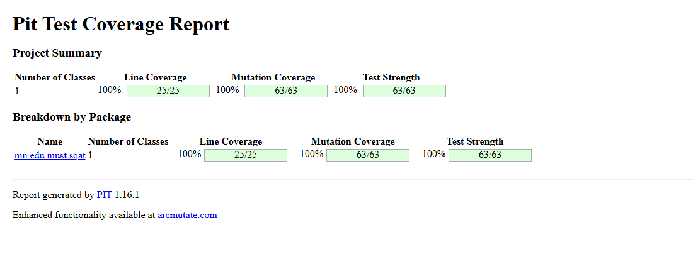

# Лаб 11 — Mutation testing: PIT-ээр тестийн чанараа хэмжих

- **Нэр:** Энхсаруул
- **Оюутны код:** B232270145

### `java -version`
```
openjdk version "21.0.12.1" 2026-08-18
OpenJDK Runtime Environment (build 21.0.12.1+1-1-24.04.4-Ubuntu)
OpenJDK 64-Bit Server VM (build 21.0.12.1+1-1-24.04.4-Ubuntu, mixed mode, sharing)
```

### `mvn -version`
```
Apache Maven 3.8.7
Maven home: /usr/share/maven
Java version: 21.0.12.1, vendor: Ubuntu, runtime: /usr/lib/jvm/java-21-openjdk-amd64
Default locale: en, platform encoding: UTF-8
OS name: "linux", version: "6.6.87.2-microsoft-standard-wsl2", arch: "amd64", family: "unix"
```

Орчин: Windows 11 + WSL2 (Ubuntu 24.04), VS Code (Remote - WSL).

> **pom.xml-ийн нэг өөрчлөлт:** Maven 3.8.7-ийн анхдагч `maven-compiler-plugin` 3.1 нь
> `maven.compiler.release=17`-г ойлгодоггүй тул `Source option 5 is no longer supported` гэж унадаг.
> Иймд `maven-compiler-plugin` 3.13.0-г pom.xml-д тогтоосон (тусдаа "Build:" commit). `src/main` огт өөрчлөгдөөгүй.

---

## Алхам 1: Эхний хэмжилт (JaCoCo vs PIT)

```bash
mvn clean verify 2>&1 | tee results/mvn-verify-start.txt
cp target/site/jacoco/jacoco.csv results/jacoco-start.csv
mvn test-compile org.pitest:pitest-maven:mutationCoverage 2>&1 | tee results/pit-start.txt
```

| Хэмжүүр | Утга | Нотолгоо |
|---|---|---|
| JaCoCo Line | **25/25 (100%)** | `results/jacoco-start.csv` (LINE_MISSED=0, LINE_COVERED=25) |
| JaCoCo Branch | **38/41** | `results/jacoco-start.csv` (BRANCH_MISSED=3, BRANCH_COVERED=38) |
| PIT Mutation | **Generated 63 mutations Killed 17 (27%)** | `results/pit-start.txt` |


**Ажиглалт:** JaCoCo-гоор мөр бүр 100% ажилласан ч 63 мутантын зөвхөн 17 нь (27%) алагдсан.
Энэ нь тестүүд кодыг *ажиллуулдаг* боловч үр дүнг нь *шалгадаггүй* гэсэн үг — `assertNotNull`, `assertTrue(0..100)`
маягийн сул assertion нь кодонд алдаа гарсан ч баригдахгүй. Хамралт нь "ямар код ажилласан", mutation score нь
"алдааг тест барьж чадах уу" гэдгийг хэмждэг.

---

## Хэсэг A: Амьд мутантуудын ангилал (starter дээр 46 SURVIVED)

| Мөр | Мутаци (PIT-ийн тайлбар) | Ангилал | Арга хэмжээ |
|---|---|---|---|
| 20 | changed conditional boundary ×2 (`score < 0` → `<= 0`, `score > 100` → `>= 100`) | Тест дутуу | Зааг тест: `letterGrade(0)="F"`, `letterGrade(100)="A"` (мутант дээр exception шиднэ) |
| 23 | changed conditional boundary (`>= 90` → `> 90`); removed conditional → true; → false; replaced return value with `""` | Тест дутуу | `assertEquals("A", letterGrade(95))`, зааг 90→"A", 89.99→"B" |
| 24 | changed conditional boundary (`>= 80` → `> 80`); removed conditional → true / false; return `""` | Тест дутуу | `assertEquals("B", 85)`, зааг 80→"B", 79.99→"C" |
| 25 | changed conditional boundary (`>= 70` → `> 70`); removed conditional → true / false; return `""` | Тест дутуу | `assertEquals("C", 75)`, зааг 70→"C", 69.99→"D" |
| 26 | changed conditional boundary (`>= 60` → `> 60`); removed conditional → true / false; return `""` | Тест дутуу | `assertEquals("D", 65)`, зааг 60→"D", 59.99→"F" |
| 27 | replaced return value with `""` | Тест дутуу | `assertEquals("F", letterGrade(30))` |
| 36 | Changed switch default to be first case ("A" нь default руу орж 0 нэмнэ) | Тест дутуу | `assertEquals(4.0, gpa({95}))` |
| 38 | Replaced double addition with subtraction (B: `total -= 3`) | Тест дутуу | `assertEquals(3.0, gpa({85}))`; `{95,85}` → 3.5 (мутант 0.5 нь 0..4 мужид багтдаг тул сул тест барьсангүй) |
| 40 | Replaced double addition with subtraction (D: `total -= 1`) | Тест дутуу | `assertEquals(1.0, gpa({65}))`; `{75,65}` → 1.5 |
| 44 | replaced double return with 0.0d | Тест дутуу | Голчийг яг утгаар шалгах (0.0 нь "0..4 мужид" багтдаг) |
| 48 | changed conditional boundary ×2 (`gpa < 0` → `<= 0`, `credits < 0` → `<= 0`); removed conditional → true (`gpa < 0` шалгалт алга болно) | Тест дутуу | Хүчинтэй зааг: `scholarship(0,0,false)=0`, `scholarship(3.0,0,false)=50`; сөрөг голч: `scholarship(-0.1,…)` → exception |
| 51 | removed conditional - replaced equality check with true / false (`hasViolation`) | Тест дутуу | `assertEquals(0, scholarship(4.0,20,true))` ба зөрчилгүй ижил оролт → 100 |
| 52 | changed conditional boundary ×2 (`gpa >= 3.8` → `>`, `credits >= 15` → `>`); removed conditional → true ×2 / false ×2; replaced int return with 0 | Тест дутуу | `(3.8,15)=100`, `(3.79,15)=70`, `(3.8,14)=70`, `(3.9,16)=100` яг утгаар |
| 53 | changed conditional boundary ×2 (`gpa >= 3.4`, `credits >= 12`); removed conditional → true ×2 / false ×2; replaced int return with 0 | Тест дутуу | `(3.4,12)=70`, `(3.39,12)=50`, `(3.4,11)=50`, `(3.5,13)=70` |
| 54 | changed conditional boundary (`gpa >= 3.0` → `>`); removed conditional → true / false; replaced int return with 0 | Тест дутуу | `(3.0,5)=50`, `(2.99,5)=0`, `(3.1,5)=50` |

**Үндэслэл:**
- **Тест дутуу (46/46):** Мутант бүр ядаж нэг оролт дээр өөр утга буцаадаг эсвэл exception-ий зан төлөвийг өөрчилдөг тул бодит зан төлөвийг өөрчилдөг — тиймээс тест дутуу.
  - *changed conditional boundary* → яг заагийн утга (90, 80, 3.8, 15 г.м.) дээр тест байхгүй.
  - *replaced return value / removed conditional / addition→subtraction* → assertion сул (`assertNotNull`, `assertTrue(муж)`), буруу утгыг ч хүлээн авдаг.
- **Equivalent (0):** Мутант бүрийг шалгахад зан төлөв нь ижил үлдэх тохиолдол олдсонгүй — бүгдийг алах тест бичих боломжтой (Хэсэг B-д баталсан).

---

## Хэсэг B: Тестүүдээ хүчтэй болгох

### B1 — Assertion-уудыг яг утгын болгох (оролт starter-тай ижил)
- `assertNotNull(letterGrade(95))` → `assertEquals("A", letterGrade(95))` (B, C, D, F мөн адил)
- `assertTrue(g >= 0 && g <= 4)` → `assertEquals(3.5, gpa({95,85}))`, `1.5`, `0.0`
- `assertTrue(s >= 0 && s <= 100)` → `assertEquals(100 / 70 / 50 / 0 / 0, …)`

### B2 — Зааг утгын тестүүд нэмэх
- `letterGrade`: 100, 90/89.99, 80/79.99, 70/69.99, 60/59.99, 0 (+ −0.01, 100.01 → exception)
- `gpa`: switch-ийн бүх үсгэн дүн тус бүр (A=4, B=3, C=2, D=1, F=0) + бүгдийг хамтад нь (= 2.0)
- `scholarship`: 3.8/15 (3.79/15, 3.8/14), 3.4/12 (3.39/12, 3.4/11), 3.0 (2.99), хязгаар gpa 0 ба 4, credits 0;
  зөрчилтэй/зөрчилгүй ижил оролт (100 ↔ 0); −0.01, 4.01, credits −1 → exception

### Хэмжилтийн явц

| Үе шат | Тест | PIT мөр (`results/pit-*.txt`) | Mutation Coverage | Test Strength | Commit |
|---|---|---|---|---|---|
| Эхлэл | 6 | `>> Generated 63 mutations Killed 17 (27%)` | 27% | 27% | `Step 1: baseline …` |
| B1-ийн дараа | 6 | `>> Generated 63 mutations Killed 45 (71%)` | 71% | 71% | `B1: exact-value assertions …` |
| B2-ийн дараа (эцсийн) | 36 | `>> Generated 63 mutations Killed 63 (100%)` | **100%** | **100%** | `B2: boundary tests …` |

- B1 нь *replaced return value*, *removed conditional → false*, *addition→subtraction*, *switch default* төрлийн 28 мутантыг алсан
  (сул assertion-ийн асуудал). Үлдсэн 18 нь бүгд *changed conditional boundary* ба `&&`/`||` доторх нэг нөхцөлийг
  "true" болгосон мутант байсан — эдгээрийг зөвхөн заагийн утга барьдаг.
- B2 нь үлдсэн 18-ыг бүгдийг алсан. Equivalent мутант байхгүй тул Mutation Coverage = Test Strength = 100%.
- Эцсийн JaCoCo (`results/jacoco-final.csv`): Line 25/25, **Branch 41/41** (эхлэлд 38/41).



---

## Хэсэг C: Гараар нэг мутант — PIT-гүйгээр

### Гар мутаци: `gpa >= 3.8` → `gpa > 3.8` (мөр 52)

```bash
sed -i "52s/gpa >= 3.8/gpa > 3.8/" src/main/java/mn/edu/must/sqat/ScholarshipCalculator.java
mvn test 2>&1 | tee results/mvn-test-manual-mutant.txt
git restore src/main     # мутацитай кодыг commit хийгээгүй
```

Үр дүн (`results/mvn-test-manual-mutant.txt`): **Tests run: 36, Failures: 1 → BUILD FAILURE**
```
[ERROR] mn.edu.must.sqat.ScholarshipCalculatorTest.scholarship_boundaries(double, int, int)[1] -- Time elapsed: 0.061 s <<< FAILURE!
org.opentest4j.AssertionFailedError: expected: <100> but was: <70>
[ERROR]   ScholarshipCalculatorTest.scholarship_boundaries:139 expected: <100> but was: <70>
```
Унасан тест нь B2-ийн `scholarship_boundaries` — `[1]` = `scholarship(3.8, 15, false)`. Яг заагийн 3.8 голчтой оюутан
мутант кодонд 100% биш 70% авсан тул барьсан. Starter-ийн сул багц энэ мутантыг барьж чадахгүй (3.9 ашигладаг, муж л шалгадаг).

### Өөрийн equivalent мутант: `scores.length == 0` → `scores.length <= 0` (мөр 31)

```bash
sed -i "31s/scores.length == 0/scores.length <= 0/" src/main/java/mn/edu/must/sqat/ScholarshipCalculator.java
mvn test 2>&1 | tee results/mvn-test-equivalent-mutant.txt   # Tests run: 36, Failures: 0 — BUILD SUCCESS
git restore src/main
```

Java-д массивын урт хэзээ ч сөрөг байж чадахгүй тул `length <= 0` ба `length == 0` нь ямар ч оролтод яг ижил үр дүн өгнө —
нэмэгдсэн `< 0` хэсэг бол хэзээ ч биелэхгүй идэвхгүй нөхцөл. Програмын ажиглагдах зан төлөв огт өөрчлөгдөхгүй учир ямар ч тест
(хүчтэй ч бай) энэ мутантыг алж чадахгүй — энэ бол жинхэнэ equivalent мутант (бүх 36 тест PASS).

---

## Дүгнэлт

Code coverage нь тест ажиллах үед кодын аль мөр, аль салаа *ажилласныг* хэмждэг бол mutation score нь кодонд жижиг алдаа
оруулахад тестүүд үүнийг *барьж чадах эсэхийг* хэмждэг. Энэ лабад starter багц Line 100%-тай байсан ч mutation score нь ердөө 27%
байсан — тест код ажиллуулж байгаа ч үр дүнг нь шалгадаггүй байв. Assertion-уудыг яг утгын болгоход (B1) score 71% болж,
зааг утгын тестүүд нэмэхэд (B2) 100% хүрсэн; хамралт эхнээсээ 100% байсан тул энэ ахицыг JaCoCo огт харуулахгүй.
Иймээс хамралт нь зайлшгүй боловч хангалтгүй нөхцөл, харин mutation score нь тестийн "алдаа илрүүлэх чадвар"-ыг шууд хэмждэг.
AI-гаар бичүүлсэн тест ихэвчлэн кодыг бүрэн ажиллуулдаг (хамралт өндөр) боловч `assertNotNull`, мужийн шалгалт зэрэг сул
assertion эсвэл одоогийн кодын гаралтыг хуулсан assertion бичих хандлагатай, заагийн утгыг алгасах нь элбэг.
Тиймээс AI-ийн тестийг mutation score-оор шалгавал аль мутант амьд үлдсэнээс нь тестийн яг сул газрыг объектив харж,
"энэ мутантыг алах тест бич" гэж зорилготойгоор сайжруулах боломжтой. Ингэснээр хамралтын тоонд хуурагдахгүй,
бодит чанартай тестийн багц бүрдүүлнэ.

---

## Файлууд

| Файл | Агуулга |
|---|---|
| `results/mvn-verify-start.txt`, `results/jacoco-start.csv` | Эхний `mvn clean verify` + JaCoCo (25/25, 38/41) |
| `results/pit-start.txt` | PIT эхлэл — Killed 17 (27%) |
| `results/pit-B1.txt` | PIT B1-ийн дараа — Killed 45 (71%) |
| `results/pit-B2.txt` | PIT эцсийн — Killed 63 (100%) |
| `results/mvn-verify-final.txt`, `results/jacoco-final.csv` | Эцсийн `mvn clean verify` + JaCoCo (25/25, 41/41) |
| `results/mvn-test-manual-mutant.txt` | Хэсэг C гар мутаци (1 тест унасан) |
| `results/mvn-test-equivalent-mutant.txt` | Хэсэг C equivalent мутант (36/36 PASS) |
| `images/jacoco-start.png`, `images/pit-final.png` | Тайлангийн зургууд |

Дахин шалгах:
```bash
mvn clean verify
mvn test-compile org.pitest:pitest-maven:mutationCoverage
```
