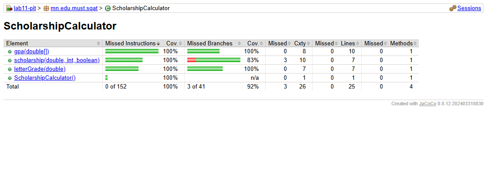

# Лаб 11 — Mutation testing: PIT-ээр тестийн чанараа хэмжих

- **Нэр:** Энхсаруул
- **Оюутны код:** B232270145

### `java -version`
```
openjdk version "21.0.12.1" 2026-08-18
OpenJDK Runtime Environment (build 21.0.12.1+1-1-24.04.4-Ubuntu)
OpenJDK 64-Bit Server VM (build 21.0.12.1+1-1-24.04.4-Ubuntu, mixed mode, sharing)
```

### `mvn -version`
```
Apache Maven 3.8.7
Maven home: /usr/share/maven
Java version: 21.0.12.1, vendor: Ubuntu, runtime: /usr/lib/jvm/java-21-openjdk-amd64
Default locale: en, platform encoding: UTF-8
OS name: "linux", version: "6.6.87.2-microsoft-standard-wsl2", arch: "amd64", family: "unix"
```

Орчин: Windows 11 + WSL2 (Ubuntu 24.04), VS Code (Remote - WSL).

> **pom.xml-ийн нэг өөрчлөлт:** Maven 3.8.7-ийн анхдагч `maven-compiler-plugin` 3.1 нь
> `maven.compiler.release=17`-г ойлгодоггүй тул `Source option 5 is no longer supported` гэж унадаг.
> Иймд `maven-compiler-plugin` 3.13.0-г pom.xml-д тогтоосон (тусдаа "Build:" commit). `src/main` огт өөрчлөгдөөгүй.

---

## Алхам 1: Эхний хэмжилт (JaCoCo vs PIT)

```bash
mvn clean verify 2>&1 | tee results/mvn-verify-start.txt
cp target/site/jacoco/jacoco.csv results/jacoco-start.csv
mvn test-compile org.pitest:pitest-maven:mutationCoverage 2>&1 | tee results/pit-start.txt
```

| Хэмжүүр | Утга | Нотолгоо |
|---|---|---|
| JaCoCo Line | **25/25 (100%)** | `results/jacoco-start.csv` (LINE_MISSED=0, LINE_COVERED=25) |
| JaCoCo Branch | **38/41** | `results/jacoco-start.csv` (BRANCH_MISSED=3, BRANCH_COVERED=38) |
| PIT Mutation | **Generated 63 mutations Killed 17 (27%)** | `results/pit-start.txt` |



**Ажиглалт:** JaCoCo-гоор мөр бүр 100% ажилласан ч 63 мутантын зөвхөн 17 нь (27%) алагдсан.
Энэ нь тестүүд кодыг *ажиллуулдаг* боловч үр дүнг нь *шалгадаггүй* гэсэн үг — `assertNotNull`, `assertTrue(0..100)`
маягийн сул assertion нь кодонд алдаа гарсан ч баригдахгүй. Хамралт нь "ямар код ажилласан", mutation score нь
"алдааг тест барьж чадах уу" гэдгийг хэмждэг.

---

## Хэсэг A: Амьд мутантуудын ангилал (starter дээр 46 SURVIVED)

| Мөр | Мутаци (PIT-ийн тайлбар) | Ангилал | Арга хэмжээ |
|---|---|---|---|
| 20 | changed conditional boundary ×2 (`score < 0` → `<= 0`, `score > 100` → `>= 100`) | Тест дутуу | Зааг тест: `letterGrade(0)="F"`, `letterGrade(100)="A"` (мутант дээр exception шиднэ) |
| 23 | changed conditional boundary (`>= 90` → `> 90`); removed conditional → true; → false; replaced return value with `""` | Тест дутуу | `assertEquals("A", letterGrade(95))`, зааг 90→"A", 89.99→"B" |
| 24 | changed conditional boundary (`>= 80` → `> 80`); removed conditional → true / false; return `""` | Тест дутуу | `assertEquals("B", 85)`, зааг 80→"B", 79.99→"C" |
| 25 | changed conditional boundary (`>= 70` → `> 70`); removed conditional → true / false; return `""` | Тест дутуу | `assertEquals("C", 75)`, зааг 70→"C", 69.99→"D" |
| 26 | changed conditional boundary (`>= 60` → `> 60`); removed conditional → true / false; return `""` | Тест дутуу | `assertEquals("D", 65)`, зааг 60→"D", 59.99→"F" |
| 27 | replaced return value with `""` | Тест дутуу | `assertEquals("F", letterGrade(30))` |
| 36 | Changed switch default to be first case ("A" нь default руу орж 0 нэмнэ) | Тест дутуу | `assertEquals(4.0, gpa({95}))` |
| 38 | Replaced double addition with subtraction (B: `total -= 3`) | Тест дутуу | `assertEquals(3.0, gpa({85}))`; `{95,85}` → 3.5 (мутант 0.5 нь 0..4 мужид багтдаг тул сул тест барьсангүй) |
| 40 | Replaced double addition with subtraction (D: `total -= 1`) | Тест дутуу | `assertEquals(1.0, gpa({65}))`; `{75,65}` → 1.5 |
| 44 | replaced double return with 0.0d | Тест дутуу | Голчийг яг утгаар шалгах (0.0 нь "0..4 мужид" багтдаг) |
| 48 | changed conditional boundary ×2 (`gpa < 0` → `<= 0`, `credits < 0` → `<= 0`); removed conditional → true (`gpa < 0` шалгалт алга болно) | Тест дутуу | Хүчинтэй зааг: `scholarship(0,0,false)=0`, `scholarship(3.0,0,false)=50`; сөрөг голч: `scholarship(-0.1,…)` → exception |
| 51 | removed conditional - replaced equality check with true / false (`hasViolation`) | Тест дутуу | `assertEquals(0, scholarship(4.0,20,true))` ба зөрчилгүй ижил оролт → 100 |
| 52 | changed conditional boundary ×2 (`gpa >= 3.8` → `>`, `credits >= 15` → `>`); removed conditional → true ×2 / false ×2; replaced int return with 0 | Тест дутуу | `(3.8,15)=100`, `(3.79,15)=70`, `(3.8,14)=70`, `(3.9,16)=100` яг утгаар |
| 53 | changed conditional boundary ×2 (`gpa >= 3.4`, `credits >= 12`); removed conditional → true ×2 / false ×2; replaced int return with 0 | Тест дутуу | `(3.4,12)=70`, `(3.39,12)=50`, `(3.4,11)=50`, `(3.5,13)=70` |
| 54 | changed conditional boundary (`gpa >= 3.0` → `>`); removed conditional → true / false; replaced int return with 0 | Тест дутуу | `(3.0,5)=50`, `(2.99,5)=0`, `(3.1,5)=50` |

**Үндэслэл:**
- **Тест дутуу (46/46):** Мутант бүр ядаж нэг оролт дээр өөр утга буцаадаг эсвэл exception-ий зан төлөвийг өөрчилдөг тул бодит зан төлөвийг өөрчилдөг — тиймээс тест дутуу.
  - *changed conditional boundary* → яг заагийн утга (90, 80, 3.8, 15 г.м.) дээр тест байхгүй.
  - *replaced return value / removed conditional / addition→subtraction* → assertion сул (`assertNotNull`, `assertTrue(муж)`), буруу утгыг ч хүлээн авдаг.
- **Equivalent (0):** Мутант бүрийг шалгахад зан төлөв нь ижил үлдэх тохиолдол олдсонгүй — бүгдийг алах тест бичих боломжтой (Хэсэг B-д баталсан).
